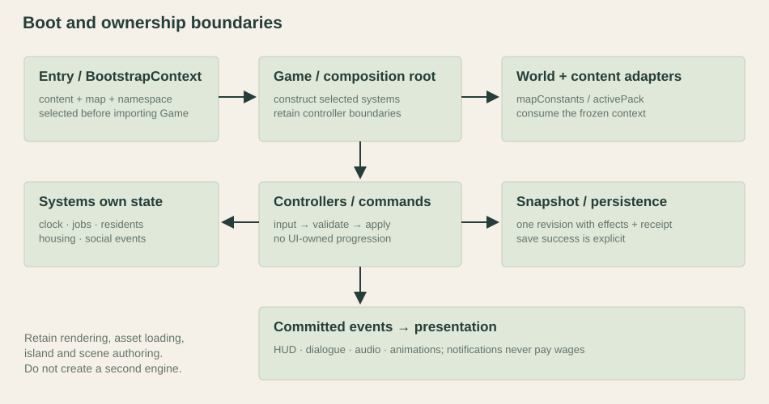
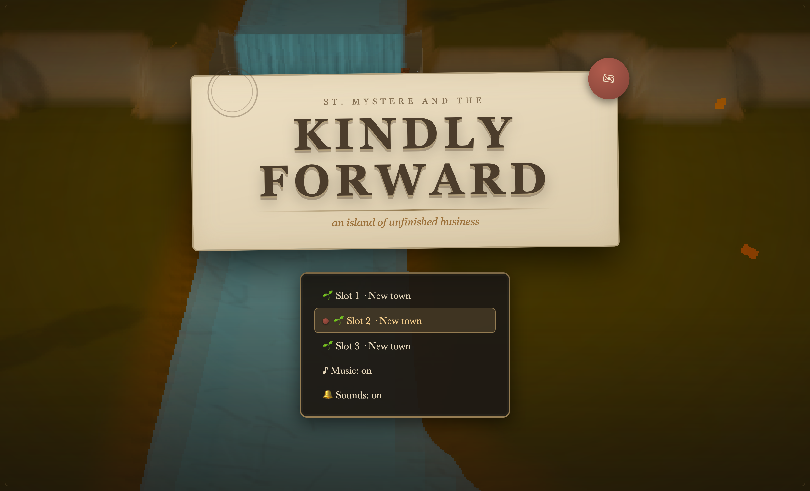
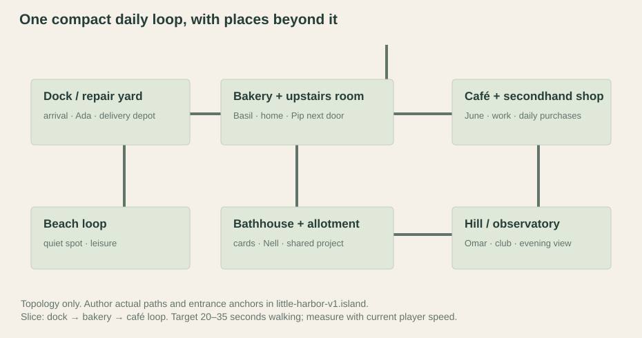
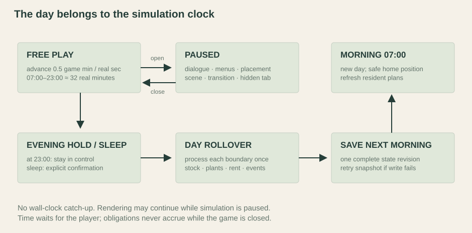
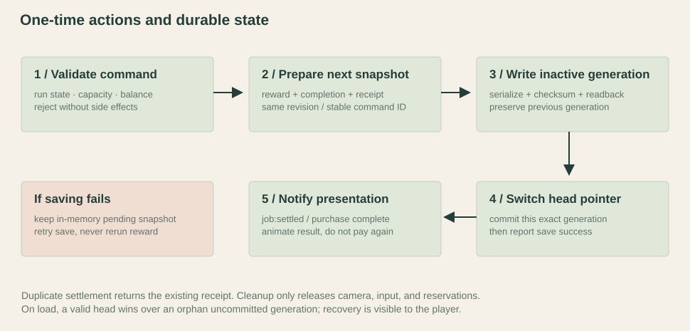
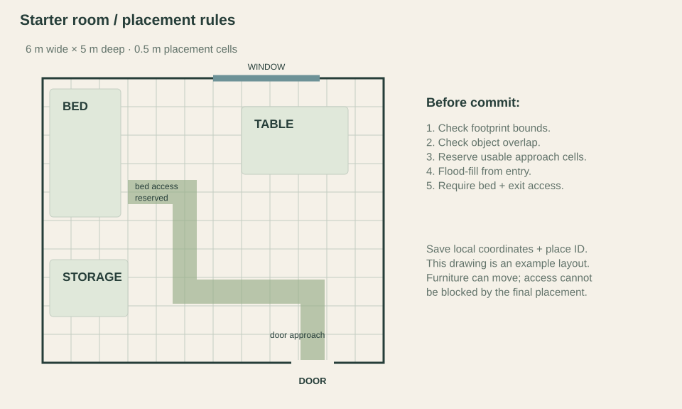
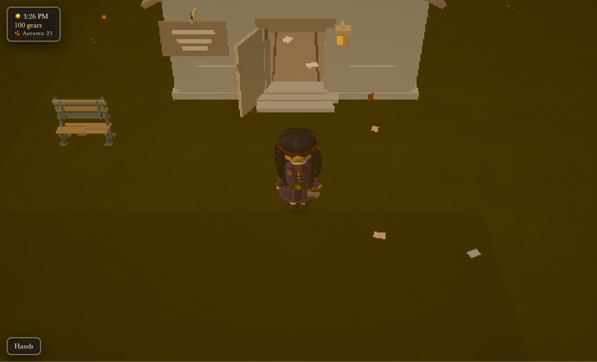

# Little Harbor — implementation design

Version 0.1 · 25 October 2026 · Proposed design, grounded in the current repository.

You move away from home and rent a room above a bakery in a working ferry town. Short jobs help you meet people and afford a home of your own. The town has existing friendships, commitments, and seasonal plans. Over your first year, you find a place among them.

This document specifies the new game; it does not claim these systems are already implemented. **Existing** describes inspected code. **Build** names proposed work. Numeric values are initial tuning defaults unless identified as a current-code fact. The three concept illustrations communicate composition and atmosphere; their lighting, density, and asset detail exceed the current renderer and are not production specifications. Current-build screenshots are unmodified Firefox captures taken during this review.

The Markdown file is the source of truth. The `/direction` webpage is generated from it. Read sections 01–03 before starting a task, then the section owning that system. The companion [TypeScript contracts](#contracts) give shared proposed types; it is a checked design artifact, not an installed runtime API.

## 01. Product boundary

**Implementation files.** Delivery artifact: the Little Harbor content pack and three-day integration fixture. Cross-system policy; no independent runtime module.

**Player outcome.** End a session with a particular plan for tomorrow: a shift, a purchase, a visit, or a place to explore. Independence and belonging are the organizing ideas. The player is a resident, not a mayor or the sole source of everyone else's progress.

**First playable scope.** Three in-game days; four residents (Basil, June, Pip, Ada); dock, bakery frontage, café, starter room, Pip's room, and one outdoor sitting spot; one café job; one shop; eight furniture items; one invitation; one overheard exchange. No fishing, construction campaign, or relationship endings are required to prove this slice.

**Release content budget.** One authored island; six principal residents plus four supporting townspeople; three short jobs; three home choices; twelve enterable places including homes and shops; four 14-day seasons; four communal seasonal events; one shared-space project per season; three leisure activities (beachcombing, potted plants, fishing). These counts are scope ceilings to cost after the slice, not evidence of existing content. The first-year celebration occurs on displayed day 56 (`dayIndex: 55`). Displayed day 57 starts a second cycle with repeatable town life and resolved first-year consequences.

**Excluded from this version.** Multiplayer, combat, hunger or survival meters, eviction, procedural town generation, free placement of public buildings, open-world ferry travel, marriage/children, full voice acting, and an unlimited narrative promise. A visit to the mainland can be a future expansion. The ferry currently brings the outside world into the town.

**Implementation acceptance.** The slice supports a full controller journey: arrive, move furniture, work, buy something, talk, invite, sleep, save, quit, reload. At least four of five first-time testers should name a self-chosen next activity after day three. Record their actual answers; this is a qualitative milestone, not market validation.

## 02. Runtime and content selection

**Implementation files.** Existing: `src/main.ts`, `src/game/Game.ts`, `src/content/activePack.ts`, `src/world/mapConstants.ts`. Add: `src/content/BootstrapContext.ts`, `src/content/ContentPack.ts`, `src/content/little-harbor/index.ts`, `src/harborMain.ts`, `harbor/index.html`.

**Existing.** `src/main.ts` preloads a fixed manifest list and constructs `Game`. `src/game/Game.ts` is the state host; domain functions are installed on its prototype. `src/content/activePack.ts` exports the Kindly Forward cast, plots, quests, letters, and title. `src/world/mapConstants.ts` builds the map at module import, consulting existing save selection. This is an import-order dependency, not a runtime map-switching API.

**Build.** Add `src/content/little-harbor/` and an explicit frozen `BootstrapContext` with `contentId`, `mapId`, `saveNamespace`, and `slotId`. Start a separate `/harbor` development entry while `/` keeps Kindly Forward. Both entries configure the context before dynamically importing `Game`; no import of `Game`, `activePack`, or `mapConstants` may occur before configuration. Type-only imports are safe. Fail clearly on a second, conflicting context. A page hosts exactly one game instance.

Refactor `activePack.ts` into a compatibility adapter over a `ContentPack` registry. Old exports remain for old callers while Little Harbor adds typed places, schedules, job definitions, and dialogue. Keep the old pack importable until the new entry passes integration tests. Do not alias new NPC IDs onto old NPC IDs. Asset references may be shared; narrative identity must not be.

Move pack-dependent field initializers (`quests`, `mail`, `calendar`, and opening runner) into a constructor-selected service bundle before enabling the new entry. Pure shared render/input fields can remain initialized as they are. An empty quest list is not a safe substitute for removing old progression callbacks.

`Game` remains the composition root. Create narrow systems for simulation time, resident schedules, activities, social events, housing, and jobs. Controllers translate input to commands and render outcomes. They do not mutate another system's state through event listeners. `core/events.ts` carries notifications after a command has committed; UI listeners must not be responsible for paying wages or advancing a story.

**Handoff.** `GameLoop.startNewGame()` chooses a pack-owned onboarding runner. `spawnNpcs()` consumes the selected cast. `mapConstants` consumes the preselected map instead of reading the old active save directly. `PersistenceController` delegates to the selected save codec. `currentTheme()` retains the same audio interface.

**Acceptance.** Boot each entry in an isolated browser context; correct title, cast, map, and save keys appear. Changing the old active slot cannot move Little Harbor to a different map. Missing content IDs stop at a readable boot error. Repeated imports do not create a second context or duplicate bus subscriptions.

## 03. Migration inventory

**Implementation files.** Existing modules are named below. Track removals in `docs/little-harbor/migration-checklist.md` when implementation starts; no deletions are authorized merely by this inventory.

**Keep with regression checks.** `RetroPipeline`, `RetroMaterial`, `CameraRig`, `SubjectProtection`, `Player`, the asset loader and manifest, skeletal/equipment animation, authored `.acre` and `.island` formats, water and weather rendering, scene/set authoring, dialogue rendering, UI primitives, audio synthesis, and the underlying save-storage abstraction.

**Adapt at a named boundary.** `Input` gains semantic actions; `Inventory` gains atomic batch operations; `FurnitureSystem` gains room IDs and stable instances; `Interior` becomes a place factory; `NPC` becomes a resident actor without power states; `Friendship` receives simulation dates and memory IDs; `ShopUI` receives catalog and stock state rather than calculating it; `TimeSystem` and `Calendar` receive simulation time; `SaveSystem` gains a separate Little Harbor codec and namespace.

**Replace for Little Harbor.** `QuestSystem`'s single ordered quest list, dead-letter progression, reactivation, dormant/low-power behavior, old plot requirements, archive donation progression, old birthdays/festivals, favor lists keyed to retired residents, the metaphysical opening, and the old finale. Keep these isolated for the old entry during migration; do not invoke them from the new pack with empty data and hope they become inert.

**Known traps to resolve.** `SocialController.talkTo()` dispatches legacy IDs and sends the new cast to generic dialogue. `InteractionController` hardcodes old doors and room occupants. `CalendarMailController.storyDone()` tests the end of the old quest chain. `PersistenceController` stores the quest index inside `completedQuests[0]`. Furniture identifies all indoor placements merely by the presence of `y`. `ShopUI` and friendship daily bonuses use real dates. These are specific integration tasks, not content-writing tasks.

**Retirement condition.** Only remove old behavior after the new pack has a complete save/reload journey and a source search shows no Little Harbor path referring to the retired IDs. Deleting legacy assets is a separate inventory decision: keep Blender sources and selected exports even if they leave the runtime manifest.

## 04. Island layout

**Implementation files.** Existing: `src/world/island/TemplateLibrary.ts`, `src/world/island/generatedLayout.ts`. Add: `src/world/island/templates/little-harbor-v1.island`, `src/content/little-harbor/places.ts`.

**Player outcome.** Learn a compact neighborhood by walking it. Useful places are visible from each other; longer routes lead to leisure and discovery.

**Existing.** `TemplateLibrary.DEFAULT_TEMPLATE_ID` selects `seed-80085`. `generatedLayout.ts` assembles authored pieces into the runtime field and cell grid. The map is authored despite several retained “generated” names. Do not reintroduce a generator.

**Build.** Copy the current map to a new `little-harbor-v1.island`; never repurpose the old ID. Author stable anchors: `dock.arrival`, `bakery.front`, `bakery.stairs`, `cafe.door`, `yard.gate`, `bathhouse.door`, `hill.path`, `beach.entry`. Resolve them through a `PlaceRegistry`, not literal coordinates in resident definitions. Give each map a `layoutVersion` so a later collision change can trigger safe relocation on load.

For the slice, make dock → bakery → café a short loop: target 20–35 seconds walking without running, subject to current movement speed. The quiet sitting spot branches off it. Show the upstairs entrance from the street. Public paths must retain at least two actor diameters of clearance; door approaches need room for an NPC and the player to pass. Test actual colliders, not only cell labels.

**Release expansion.** Add the bathhouse and allotment behind the commercial block, the repair yard by the ferry, and observatory on the hill. The beach path returns to town rather than dead-ending. Keep shop functions available from day one; seasonal projects improve shared places, not essential access.

**Acceptance.** Walk each anchor pair with keyboard and pad. An authored route graph reports disconnected entrances. Spawn and every door exit pass standability and collision probes. Map edits preserve IDs; a missing anchor is a build error. A screenshot from the dock shows a plausible path toward the player's home.

## 05. Places and interior transitions

**Implementation files.** Adapt: `src/world/Interior.ts`, `src/game/modules/InteractionController.ts`. Add: `src/world/PlaceRegistry.ts`, `src/content/little-harbor/interiors.ts`.

**Existing.** `Interior.ts` provides local-to-world conversion, colliders, door checks, room construction, and hotspots. `InteractionController.getInterior()` switches on `emporium`, `archive`, and old houses. `enterInterior()` stations one named NPC. Rooms are arranged at synthetic world origins; they are not physically inside the outdoor mesh.

**Build.** Define `PlaceDef` with stable ID, outdoor entrance anchor, room factory ID, spawn marker, exit marker, opening hours, access policy, resident capacity, and interaction anchors. Preserve the separate-room technique. Multiple indoor residents are represented by schedule state; replace the single `stationedNpc`/`stationedReturn` bookkeeping with a room occupant set.

Transition sequence: reserve destination → block movement input → fade out → release old room occupancy → instantiate destination → place actors and furniture in local coordinates → restore camera and ambient sound → fade in → release input. `finally` releases locks and presentation resources only. If loading fails, restore the previous room and position and display a retry prompt. Do not save an actor halfway through the fade.

**Data rule.** Save `placeId` plus local position; outdoor coordinates use `placeId: 'town'`. A door is an entrance to a place, not evidence that a plot is “built.” The initial town's shops are authored and usable without construction quests. After closing, shops finish the current transaction and let the player leave; nobody becomes trapped inside.

**Acceptance.** Repeated enter/exit does not duplicate meshes or colliders. Two residents can occupy the café. Saving in the starter room reloads there with correct camera, weather visibility, and furniture. Invalid place/position loads at that place's safe marker, then at the home door if the place was removed.

## 06. Input and interaction focus

**Implementation files.** Adapt: `src/player/Input.ts`, `src/game/modules/InteractionController.ts`, `src/game/modules/FixtureInteraction.ts`. Add: `src/interaction/InteractionResolver.ts`, `src/player/ActionBindings.ts`.

**Existing.** `Input` merges keyboard and gamepad into key codes. Both A and X currently become `KeyE`; there is no full action mapping for ledger or furniture rotation. `runPrimaryAction()` takes the first candidate and fires it on E. A nearby placed item currently offers pickup ahead of ordinary talk.

**Build.** Add semantic actions: `confirm`, `cancel`, `interact`, `alternate`, `pockets`, `journal`, `rotate`, `run`, `focusNext`. Keep key-code compatibility while controllers move one at a time. Default pad bindings: A interact/confirm; B cancel; X alternate/focus-next depending on context; Y pockets; View journal; RB rotate in decoration; triggers run. Show the actual connected device's prompts and expose remapping. Menus consume actions before world interactions.

Each `InteractionCandidate` has stable ID, owner, anchor, radius, priority, prompt key, availability reason, and command. Resolve modal actions first; then standing from a seat; then explicit job or fixture interaction; then focused resident; then tool use. Pickup belongs to decoration mode or an explicit alternate action. Within equal priority prefer aim alignment, then distance, then stable ID. Hold the chosen target until it leaves a 15% enlarged range or the player cycles focus, preventing prompt flicker.

**Acceptance.** A seated player can always stand. Talking beside a chair does not remove the chair. One press cannot both confirm a menu and activate a world object. All slice actions are reachable on pad. Disconnecting a pad clears held input; focus returns to a meaningful menu item after closing a submenu.

## 07. Simulation clock

**Implementation files.** Add: `src/systems/SimClock.ts`. Adapt: `src/systems/TimeSystem.ts`, `src/game/modules/GameLoop.ts`; route the old pack through the existing wall-clock adapter.

**Existing.** `TimeSystem.hour` reads `new Date()`. `GameLoop.fixedUpdate()` calls `time.update()` before modal handling. `frame()` queues discarded real time into weather. Simply replacing the displayed clock would leave gameplay inconsistent.

**Build.** `SimClock` owns `{ dayIndex, minuteOfDay }`. Internal `dayIndex: 0` (displayed day 1) starts at 15:00 for arrival; ordinary mornings start at 07:00. Initial rate: one real second equals 0.5 game minute; 07:00–23:00 therefore takes 32 minutes of unpaused play. Store fractions internally; display rounded-down minutes. Offer 0.5×/1× clock speed as an accessibility setting. These are tunable defaults, not measured ideal pacing.

Advance once per fixed simulation tick, only in free play. Clock pauses for dialogue, menus, placement, cutscenes, transition fades, explicit pause, and hidden tabs. The render/animation clock remains separate. At 23:00 the clock holds, with a “Head home when you're ready” notice; the player is not teleported or penalized. Sleep commits the next morning. A wait action advances only to an explicitly selected same-day appointment and processes crossed boundaries.

**Boundary handling.** Enumerate every crossed hour and day in order; do not emit only the final hour after a jump. The day-rollover operation has a stable ID and commits once. It refreshes offers, stock, plant state, rent due, weather plan, appointments, and resident plans in a documented order. On a failed save, keep the pending morning in memory and offer retry; a reload returns to the last durable day without half-applied payments.

**Handoff.** Preserve `hour`, `phase`, `isNight`, `clockText`, `daylightAt()` consumers. Replace `Date` in `applySchedules`, daily-loop detection, friendship, shop stock, calendar events, and resource respawns. Keep wall time only for save timestamps, diagnostics, and purely presentational timing. Remove Little Harbor's offscreen weather catch-up based on real elapsed time.

**Acceptance.** Hide the tab for an hour: no date, wage, plant, stock, or relationship change. Pause at 22:59 and resume reliably. Crossing two hours emits both boundaries once. Save/load reproduces hour, season, daily offers, and weather.

## 08. Calendar and recurring events

**Implementation files.** Adapt: `src/systems/Calendar.ts`. Add: `src/content/little-harbor/calendar.ts`, `src/systems/CalendarEvents.ts`.

**Build.** The first year is 56 days: 14 per season, two seven-day weeks each. `season = floor(dayIndex / 14) % 4`; `dayOfSeason = dayIndex % 14 + 1`; `weekday = dayIndex % 7`; year is `floor(dayIndex / 56) + 1`. Day 0 is Spring 1. The first anniversary celebration occupies dayIndex 55 and remains available on day 56 if missed.

`Calendar` becomes a view of `SimClock`, not a second time owner. Replace old `FESTIVALS` and `BIRTHDAYS` with pack data. Event occurrences have IDs such as `spring-market:y1:w1`, open/close minutes, participating residents, venue, outcome rules, and recurrence. Mark attendance separately from the town event occurring. Missing a market does not halt the season.

**Initial events.** Weekly market on weekday 5; astronomy club on weekday 3 at 19:00; cards at the bathhouse on weekdays 1 and 4. Seasonal highlights: spring harbor cleanup/picnic, summer ferry parade, autumn garden supper, winter lantern evening. Each recurring event needs a base scene, two ordinary variants, and a missed-event recap before adding more events.

**Acceptance.** Fast-forward a test year and verify occurrence IDs are unique. A resident cannot be required at two events without a priority rule. Repeated load at an event's start cannot duplicate rewards. Important invitations get another date; routine events can simply pass.

## 09. Resident identity and scheduling

**Implementation files.** Adapt: `src/characters/NPC.ts`, `src/content/types.ts`, `src/game/modules/GameLoop.ts`. Add: `src/systems/ResidentSystem.ts`, `src/content/little-harbor/residents.ts`, `src/content/little-harbor/schedules.ts`.

**Existing.** `CastMember` combines model factories with literal home coordinates and schedule blocks. `NPC` still has `dormant`, `active`, and `low-power` states. `GameLoop.updateResidences()` and `NPC.applySchedule()` control where actors appear. They do not yet provide a full indoor/outdoor activity scheduler.

**Build.** Keep `NPC` as the rendered actor and locomotion owner. Add `ResidentSystem` for canonical location, current activity, active reservation, daily plan, and story facts. Little Harbor residents are always alive and active; sleeping is an activity in a place, not power loss. Separate `ResidentId` from `AssetId` so Ada may temporarily use Rowan's rig without inheriting Rowan's story.

A schedule block names a place and activity anchor, not coordinates: `[startMinute, endMinute)`, `placeId`, `anchorId`, `activity`, fallback, and priority. Priority: scene reservation > accepted appointment > accepted job participation > calendar event > ordinary schedule. A higher-priority activity suspends a lower one; it never erases the base schedule. Use `TraversalGraph`/cell walkability where suitable, with a small waypoint graph joining doors. Existing collision steering alone is not proof of successful pathfinding.

Onscreen residents walk to the next reachable anchor. After two seconds without progress, replan once; after another failure, move them only behind a door/fade or offscreen and log the broken route. Offscreen residents update semantic location at the schedule boundary. Do not simulate all of their walking. Every anchor has capacity; reserve/release seats and work spots to prevent overlapping actors. Reload reconstructs reservations from activities, not stale object references.

**Slice schedules.** Basil: bakery 07–12, errands 12–14, bakery 14–18, home 18–23. June: café 08–14, breakwater 14–16, café 16–19, rehearsal 19–21, home thereafter. Ada: dock 07–12, home 12–15, yard 15–18, bathhouse 18–20. Pip: room 07–10, market errands 10–13, odd job 13–17, café or home after 17. Time outside a listed interval uses home. Rain moves June's breakwater activity to the café window seat.

**Acceptance.** Each resident completes a day without a stranded route or duplicated room presence. Talk suspends their movement and resumes it afterward. An appointment displaces ordinary activity and releases correctly on cancellation. A nearby player can see two residents meet without triggering their interaction.

## 10. Dialogue selection and writing

**Implementation files.** Adapt: `src/game/modules/SocialController.ts`, `src/interaction/DialogueBox.ts`. Add: `src/content/little-harbor/dialogue.ts`, `src/systems/DialogueSelector.ts`, `src/content/little-harbor/locales/en.ts`.

**Existing.** Keep `DialogueBox` for text and choices, `SpeechBubbles` for overheard lines, and the cast speaker appearance registration. Replace content dispatch in `SocialController` and the generic old gift/favor tables. Stage directions in the Kindly Forward heart-scene adapter are not finished dialogue to carry forward.

**Build.** Store lines under stable localization keys. `DialogueRule` has ID, speaker/participants, conditions, priority, cooldown, lines, choices, and optional completion command. Conditions are a small typed union: story fact, relationship band, event attendance, job result, place, season, hour range. No arbitrary JavaScript in content files.

Selection order: response to a just-completed action → accepted appointment context → unseen story beat → place/activity comment → ordinary pool. Never interrupt a conversation to surface a higher priority line. Track seen IDs and the last three ordinary exchanges per resident; use deterministic choice among eligible unseen entries. When a pool is exhausted, permit repeat with a day cooldown rather than inventing dialogue at runtime.

**Slice writing package.** Per resident: one introduction, six ordinary two-line exchanges, two place/activity exchanges, one work response if applicable, one visit response, and one “busy but available later” line. Add one Basil/Ada and one June/Pip overheard exchange with participant IDs. These are content minimums for the slice, not a guarantee that six exchanges sustain a release year.

**Acceptance.** The first ten interactions have no repeated introduction or old Mayor/Postmaster address. Missing translation falls back to source language and logs a key, not an empty bubble. A choice can be cancelled safely; effects occur after the chosen response, once. Screen-reader-friendly DOM text and conversation history remain accessible without racing the typewriter animation.

## 11. Friendship and social memory

**Implementation files.** Adapt or wrap: `src/systems/Friendship.ts`. Add: `src/systems/RelationshipSystem.ts`, `src/content/little-harbor/relationships.ts`.

**Build.** Preserve the idea of per-resident state and gift tastes, but replace daily wall-clock strings and indexed heart scenes. Use hidden familiarity 0–100, stable memory flags, accepted boundaries, and `lastCreditedDay` keyed to game day. Display human descriptions (“knows your usual order”), not hearts or point totals.

Initial tuning: meaningful first conversation +1/day; shared activity +2/day; completed invitation +3 per occurrence; liked gift +1/day; loved gift +2/day. Cap general familiarity gains at 4 per resident per game day. Gifts cannot exceed 2 of that cap. Acquaintance at 5, familiar at 15, friend at 30; specific privileges also require an authored memory. No passive absence decay. Declining an invitation is not a penalty. A missed accepted commitment unlocks an apology exchange; it does not permanently close a story.

Friendship changes concrete behavior: casual greetings, lending a tool, invitations, remembering preferences, visiting the room. Residents must also initiate gifts or help. Persist only authored significant memories, not a log of every footstep or spoken syllable.

**Handoff.** Adapt `Friendship` or introduce `RelationshipSystem` behind its caller seam. Keep `giftVerdict()` with validated Little Harbor item IDs. Replace `pendingScene()`'s numeric index with eligible scene IDs. No conversion from old character hearts to new identities.

**Acceptance.** Repeating talk/gift actions cannot bypass the cap. Sleeping and reloading do not award twice. A declined visit does not reduce familiarity. Seeing a scene marks the correct stable ID even after content order changes. At least one slice interaction has a resident doing something for the player.

## 12. Job lifecycle

**Implementation files.** Add: `src/systems/JobSystem.ts`, `src/game/modules/JobController.ts`, `src/content/little-harbor/jobs.ts`. Command persistence is owned by the save/command boundary in section 27.

**Player outcome.** A short, understandable job provides spending money and contact with residents. It should fit within a day that still contains leisure.

**Build.** `JobSystem` owns offers and `JobRun` state: `offered → active → readyToSettle → settled`, or `active → abandoned`. Persist `runId`, kind, day, accepted step IDs, step progress, reward, and settlement status. One active job at a time; one paid run of each kind per day. Practice can be repeated unpaid. Work offers do not depend on friendship or story completion.

Start validates opening hours, destination availability, and no conflicting active job. A job reserves needed actors and anchors. Each step is an authored interaction condition, not a free-form quest string. A correct action completes one step. Wrong attempts do not consume personal items or reduce pay. Leaving offers “continue later today” or “finish early”; early exit settles a fixed show-up payment once and forfeits the completion portion. At day rollover, an unfinished run uses the same early-exit policy.

**Transaction.** `settle(runId)` validates current state, prepares the currency delta and the settled state together, commits one snapshot revision, then emits `job:settled`. The receipt is retained with the run; a duplicate command returns the original receipt. Failed storage produces “earned, not saved yet” plus retry, not a false save-success toast. Never grant rewards from a scene's `finally` block.

**Acceptance.** Quit before accepting, mid-step, before settlement, and after settlement. Resume without duplicate wage, orphan reservation, or missing props. Calling `settle` twice changes money once. A full personal inventory cannot prevent job completion.

## 13. Café shift

**Implementation files.** Add job definitions in `src/content/little-harbor/jobs/cafe.ts`; handle work-prop interaction in `src/game/modules/JobController.ts`. Reuse equipment controllers without adding inventory items for work tokens.

**Existing reuse.** `Interior` hotspots, `DialogueBox`, equipment sockets, carry poses, and `SceneDirector` can stage the work. There is no existing café job; do not describe `ShopUI` as one.

**Build.** At the staff counter, June offers a three-order shift. Each order contains a resident, fixed seat, drink token, and food token. The player reads the order, picks the matching prepared tray at the counter, serves the seat, and returns a used cup. Work objects live in job state and render through equipment; they never occupy paid-inventory slots.

There is no queue timer, food spoilage, dexterity grade, or customer anger meter. A wrong tray receives a specific reminder and returns to the counter. An order remains available in the journal. Target 4–6 real minutes of play. Initial reward: 60 coins on completion, or 20 once for finishing early after at least one served order. One resident preference is learned through ordinary conversation, not a mandatory quiz.

The café's normal customers continue ambient behavior in unreserved seats. Serving only advances the job when the target `runId/orderId` matches. Freeze simulation time for order dialogue but not for walking between stations. An order started shortly before closing can finish; do not spawn new orders after all three are served.

**Acceptance.** Three valid orders settle one reward. Wrong target, wrong tray, cancelled dialogue, full pockets, and a reload with a held tray all have defined behavior. A nonworking player can still enter, buy food, and meet June. Café work cannot become a prerequisite for friendship.

## 14. Neighborhood delivery work

**Implementation files.** Add: `src/content/little-harbor/jobs/delivery.ts`. Extract pure checks from `src/systems/MailSystem.ts` only if they do not import the old letter tables.

**Existing reuse.** Mail custody validation, recipient checks, and return-to-drawer ideas are useful. `MailSystem` is coupled to `activeLetters()`, story readiness, and required buildings, so do not make ordinary paid deliveries reuse those narrative gates.

**Build.** Add delivery job data under the common job lifecycle. Three parcels each carry stable destination place ID, recipient ID, and a short address clue. Keep parcels in a job satchel separate from personal inventory; render the existing satchel model. Parcel state is `atDepot`, `carried`, or `handedOver` within its run.

A recipient at home can accept at the door even if their interior is unavailable. If away, provide their posted availability or permit a named household drop-off after confirmation. Wrong recipients keep the parcel and offer a clue. Returning parcels cancels uncompleted stops without corrupting custody. Initial complete pay: 50 coins; early exit after one successful delivery: 15 coins. No tips based on speed.

**Handoff.** Extract pure handoff validation from `MailSystem` only if it reduces duplication without importing `activeLetters`. Disable `storyDone()` checks and required-building gates for this job. Keep narrative family letters as journal correspondence; reading them does not reuse delivery-job settlement.

**Acceptance.** A parcel has exactly one custody state. Handoff and wage cannot duplicate on reload. Every destination has a reachable door anchor. A route is completable regardless of personal inventory capacity, and an absent recipient never stalls the day.

## 15. Repair-yard work

**Implementation files.** Add: `src/content/little-harbor/jobs/repair.ts`. Reuse workbench presentation from `src/game/modules/CommerceController.ts`; distinguish job-token and personal-material commands.

**Existing reuse.** `CommerceController.openWorkbench()`, crafting recipes, equipment props, and item definitions are useful foundations. Old scrap/gear progression is not the new economy.

**Build.** Ada offers one small repair: a stool, a crate latch, or a lamp. Inspect the object to reveal a fixed checklist, collect supplied parts from the yard shelf, and perform two or three clear contextual actions. Finish with a visible repaired object. Target 4–6 real minutes, initial pay 55 coins, early-exit pay 15 after the first repair step.

Do not require the player to buy components or farm scrap for paid employment. Job materials are virtual work tokens. Personal crafting is separate: after learning a recipe, the player may use owned materials at a home workbench. Cosmetic repair variants are content; a physics assembly system is outside scope.

**Acceptance.** Tool/part prompts are readable without color. Cancelling midway preserves the run. Completing work unlocks an appropriate personal recipe at most once. Selling or discarding personal items cannot invalidate the job. The repaired prop swaps state only after the job step commits.

## 16. Inventory and shops

**Implementation files.** Adapt: `src/systems/Inventory.ts`, `src/ui/ShopUI.ts`. Add: `src/systems/ShopSystem.ts`, `src/content/little-harbor/items.ts`, `src/content/little-harbor/shops.ts`.

**Existing.** `Inventory` has 20 slots and stack counts up to 9. `add(count > 1)` may partially mutate before reporting failure when full. `ShopUI.rollStock()` uses `Date.now()` and reads the global item catalog. These need fixes before crafting or batch rewards depend on them.

**Build.** Keep 20 pockets for the initial release, with a home storage container and separate job satchel. Add `planInventoryDelta()` that computes removals/additions on a copy and either returns a complete next inventory or a typed failure. Commit all or nothing. Required story keys and the room key live in a keyring, not droppable slots. Furniture transferred from placement to storage does not vanish if pockets are full.

Move stock selection into `ShopSystem` with `shopId`, `dayIndex`, stable world seed, sold counts, and pinned essentials. The UI renders that state. Starter chair, lamp, table, and basic clothing always remain orderable; daily rotation adds variety. Purchasing validates stock, balance, and destination capacity in one command. Sell value begins at 25% of buy value, rounded down; job props and keys are unsellable.

**Acceptance.** A multi-item addition into insufficient space leaves inventory unchanged. Failed purchase changes neither stock nor coins. The same save/day has the same stock after reload. Shops use the Little Harbor catalog only; retired relics do not appear through global enumeration.

## 17. Economy and housing payments

**Implementation files.** Add: `src/content/little-harbor/economy.ts`; housing obligation state belongs to `HousingSystem`, currency mutations to `GameCommands`. Adapt `HUD` currency labels during cutover.

**Build.** Use integer coins. Keep the old `gears` implementation behind a currency adapter temporarily; new content and UI say coins. Rename storage to `wallet.coins` in the new save, avoiding old/new fields that can diverge.

Initial tuning: 80 starting coins; café 60, deliveries 50, repair 55; ordinary snack 5; chair 35; lamp 45; table 90; shelf 70; wall/floor finish 60; home workbench 180. One café shift can fund a small furnishing and several social purchases. Expected first lamp: day one or two, not ten sessions of saving. These prices must be evaluated together, not adjusted independently without a purchase-path check.

Housing is free through `dayIndex: 6` (the first seven displayed days). At `dayIndex: 7` and each seven-day boundary afterward, offer a 90-coin contribution. No automatic negative balance or eviction. At most one unpaid contribution is outstanding; later weeks do not compound debt. A special assistance shift can clear the obligation instead of paying its normal wage. Show the exchange before acceptance. The player can always sleep, use storage, and keep possessions.

**Long-term sinks.** Optional larger apartment: 900 coins; garden cottage: 1,400; retain the starter room as a valid permanent choice. Decoration and leisure consume most discretionary money. No stamina purchases or paid access to friendship.

**Acceptance.** A simulation of two paid shifts plus one housing contribution leaves meaningful discretionary income. A no-job week remains playable. Replaying settlement cannot generate money. Shop buy/sell cycles cannot profit. Test day 7 rollover and assistance completion across save failure.

## 18. Home ownership and furnishing

**Implementation files.** Adapt: `src/systems/FurnitureSystem.ts`, `src/world/Interior.ts`. Add: `src/systems/HousingSystem.ts`, `src/world/RoomPlacementGrid.ts`, `src/content/little-harbor/housing.ts`.

**Existing.** `houseTier`, wallpaper, floor, and `buildPlayerHouseInterior()` support a single generic home. Furniture placements store `x/z/y`, not a room identity. `rearmIndoorColliders()` reattaches every indoor piece to the current indoor collider context.

**Build.** `HousingSystem` owns occupied residence ID, owned residences, storage, room finish IDs, and payment state. `FurnitureSystem` remains the placement/rendering owner but uses `PlacedInstance { instanceId, itemId, placeId, localX, localZ, rotationQuarter }`. Outdoor placement uses town cells. Resolve to world coordinates only at render/collision boundaries. A move-home command moves possessions to storage and changes the home anchor; it never destroys placements silently.

Starter room: prototype a 6 × 5 metre interior, door at one end, window opposite, bed, lamp, storage trunk, and room for a table and two chairs. Use a 0.5-metre placement grid with 90-degree rotation. Keep the authored camera and cutaway readable. The bed and exit each reserve an access cell plus a connected path from the entrance. Validate connectivity after tentative placement; show the blocked path and reject the placement if either becomes inaccessible.

Furniture interaction is separate from pickup. Beds sleep, chairs sit, shelves display small objects, lamps toggle, tables support visits, workbenches craft. Extend the `.gameobj` component model carefully or resolve furniture interaction descriptors through a shared registry; don't special-case dozens of item IDs in `InteractionController`.

**Transaction.** Starting a move does not remove the original piece. Preview a tentative transform. Confirm commits the new transform and collision claim together. Cancel restores the original. Deleting/moving to storage verifies capacity or uses the home trunk's safe overflow. Decorations cannot be edited during an active visit's reserved seating.

**Acceptance.** Place two similar chairs in different rooms, save, reload, and pick up only the correct one. Door and bed remain reachable. Cancel after rotation is lossless. Colliders and light references are released on removal; repeated redecorating does not accumulate lights or meshes.

## 19. Invitations and home visits

**Implementation files.** Add: `src/systems/SocialEventSystem.ts`, `src/content/little-harbor/invitations.ts`; staging uses the existing scene host with new room bindings.

**Build.** `SocialEventSystem` owns invitation instances: `offered`, `accepted`, `active`, `completed`, `declined`, `missed`. Invitations store stable occurrence ID, host/guest, place, proposed time window, reservation anchors, and aftermath line IDs. The player chooses a convenient window from two valid slots; the scheduler rejects conflicts before showing choices.

For the three-day slice (`dayIndex` 0–2), Pip offers to visit on displayed day 3 (`dayIndex: 2`) between 18:00 and 20:00. The invitation works with the starter stool and bed-edge fallback; buying a dining set is not required. At the start, Pip reaches the door, knocks, and waits for acknowledgement. If the player is elsewhere, the journal shows “Pip is at your door”; after the window, a friendly reschedule note replaces the visit. No affinity loss.

Visits contain an arrival, one comment on a tagged displayed object, a short optional conversation, and departure. A “wrap up” choice ends politely. Reserve seating only for the visit. Pausing or opening a menu pauses its clock. Finishing sleep ends or reschedules a pending visit explicitly, never leaves an NPC inside an unloaded room.

**Acceptance.** Decline, miss, reschedule, cancel, save during, and complete each preserve exactly one event occurrence. Moving furniture before arrival recalculates seating. Removing a displayed object does not break the conversation rule. At least one visitor comment refers to a real item the player placed.

## 20. Leisure activities

**Implementation files.** Adapt: `src/systems/ItemDrops.ts`, `src/systems/FishingSystem.ts`. Add: `src/systems/PlantSystem.ts`, `src/content/little-harbor/leisure.ts`.

**Beachcombing.** Reuse `ItemDrops` and discovery tracking. Spawn a bounded deterministic daily set from valid beach cells. Pickups can be sold, gifted, or displayed. Persist collected spawn IDs; a reload cannot farm the same shell. Keep a few empty stretches so the beach reads as a place, not a loot carpet.

**Potted plants.** New `PlantSystem` instances attach to placed pots, storing seed ID, planted day, watered-day IDs, and stage. Water at most once per day. Two watered days reach the next stage; missing water pauses growth without killing the plant. Outdoor rain counts once; indoor rain never counts. Sleep uses crossed game days, not wall-clock elapsed time. A removed pot keeps plant state in storage.

**Fishing.** Existing `FishingSystem` is present but disabled by `ACTIVE_CAPABILITIES.fishing`. Leave it off in the slice. Before release, validate shoreline legality, rod acquisition, cast/strike/cancel flows, camera, inventory-full handling, and accessibility with an extended bite window. No plot or friendship gate may require a rare catch. Returning a catch to the sea is always available if storage is full.

**Acceptance.** Each activity can produce an object, a memory, or a quiet moment worth choosing voluntarily. Resource saves use stable spawn/instance IDs. Fishing remains unavailable in the released pack unless its complete controller journey passes; remove its advertised feature if it does not.

## 21. Shared projects and resident stories

**Implementation files.** Add: `src/systems/StorySystem.ts`, `src/content/little-harbor/storyBeats.ts`, `src/content/little-harbor/projects.ts`. Do not extend the ordered `QuestSystem` to fake independent plans.

**Existing.** The ordered `QuestSystem` cannot express independent resident plans or a committee project. Replace it for Little Harbor with facts, activity availability, and independent story-beat state; retain the HUD space for a player-pinned plan.

**Build.** A `StoryBeatDef` owns eligibility conditions, participants, location, scene, fallback recap, and effects. A `ProjectDef` owns milestone dates, resident contributions, optional player contributions, and visual stages. Use stable IDs. Project advancement from NPC work occurs at authored calendar boundaries, even if the player ignores it. The player can affect choices and add personal touches, not become the only source of materials.

First project: the bathhouse garden. Nell organizes it in spring, Ada repairs a gate, Basil supplies food, and the player can choose and place one planter. The garden opens on its planned day regardless; participation changes a thank-you, a decoration, and a later invitation. No essential job or shop depends on participation.

**First-year resident plans.** June prepares and attends an audition; Ada takes a short holiday; Pip chooses whether to move to a larger room; Omar hosts a better-attended club night; Nell learns to swim; Basil negotiates a bakery menu change with his sister. Every plan needs setup, an intermediate ordinary-life change, one optional player involvement, a resolution, and an aftermath routine. The player does not decide every adult's life. Basil's sister is a supporting resident; do not refer to a missing offscreen relationship as though it were implemented.

**Acceptance.** Advance a year without doing projects: people still live, and no story deadlocks. Participating changes the documented aftermath only once. Reordering content files never changes saved outcomes. Missed one-off scenes are summarized in dialogue; essential facts remain discoverable.

## 22. Opening and authored scenes

**Implementation files.** Adapt: `src/cutscene/OpeningPlayer.ts`, `src/cutscene/scene/GameSceneHost.ts`. Add: `src/cutscene/HarborOpening.ts`, new arrival/welcome `.scene` and `.set` files in the existing scene/set directories.

**Existing.** `OpeningPlayer`, the ferry set, `kindly-opening.scene`, `GameSceneHost`, virtual cameras, equipment animation, and the scene editor provide a valuable production pipeline. Reuse the ferry and scene runner; replace the script, role of the Keeper, supernatural fog passage, and office assignment.

**Build.** Author `harbor-arrival.scene` and `bakery-welcome.scene`. Start day 0 at 15:00. The ferry ride is short; an ordinary passenger gives directions. Return movement control at the dock within a target 60–90 seconds. The baker gives the room key and leaves for work. The player enters the room, unpacks three starter objects, and may explore before sleeping. Name entry and appearance precede the arrival or occur at the rental register; neither should imply a predetermined postal identity.

Scene completion returns `completed`, `skipped`, `cancelled`, or `failed`. Define explicit effects for completed and skipped outcomes: room access, initial inventory, journal introduction, and safe player position. Cancellation/failure does not grant those effects unless a documented checkpoint was already committed. Use `finally` only to restore control, camera, audio, reservations, and letterboxing. The existing director's `Promise<void>` needs a host wrapper or a typed result extension.

**Acceptance.** Skip at every beat: end in a valid room-access state, no double starter money, no frozen controls. An asset-load failure offers retry or a text recap with the same required setup. A clean new game never displays Albert's old objective or an undeliverable-letter prompt.

## 23. Journal and HUD

**Implementation files.** Adapt: `src/ui/HUD.ts`, `src/ui/InventoryUI.ts`, `src/ui/kit.ts`. Add: `src/ui/JournalUI.ts`, `src/systems/JournalState.ts`; retain `LedgerUI` only for the old pack.

**Build.** Replace the case-file ledger with a journal containing Today, People, Work, Home, and Correspondence. Today shows accepted commitments and one player-pinned plan; it does not prescribe an endless quest list. People records only information the player has learned, including usual locations and opening hours. Work shows the current run and held work props. Home shows storage and payment status. Family letters belong under Correspondence.

Keep time, season/weather, money, and the current interaction prompt. Hide permanent tool clutter unless a tool is selected. Show a small unsaved indicator after committed changes and a clear retryable error on storage failure. The journal must distinguish “shop closed” from “resident not here” and offer a next useful time, not a silent disabled button.

**Handoff.** Reuse `LedgerUI` layout primitives where helpful, not its case-file data model. `HUD.setGears` becomes a currency-label adapter during transition. Keep `InventoryUI` selection behavior while job items move to their own panel. Replace emoji-only icons with consistent labeled icons; display screen-reader names and scalable text.

**Acceptance.** Complete the slice with controller, sound off, and 150% text. Focus never moves behind a modal. Long translated names wrap without covering the confirm action. The player can determine where to go for an accepted visit without opening a developer console.

## 24. Art and animation production

**Implementation files.** Author in existing `assets/characters/`, `assets/props/`, and `assets/sets/` conventions. Update `public/assets/manifest.json` only for selected runtime exports; add content-pack asset lists for release packaging.

**Existing.** `assets/CONVENTION.md` establishes coordinates, material treatment, rig contracts, and target budgets. Runtime models are selected through `public/assets/manifest.json`, not by choosing the newest filename. Keep Blender source files and the equipment-v1 contract.

**Build.** Treat current bodies as prototype casting. Proposed temporary mapping: player → postmaster, Basil → Albert, Ada → Rowan, June → Liliane, Omar → Niko, Nell → Amina, Pip → Vittorio. These are explicit placeholders, not final character design or a mapping of biographies. Do not use Mira's child silhouette for an adult without a deliberate redesign. New resident IDs resolve to asset aliases; saves never store GLB filenames.

Remove postal insignia from the player and add ordinary clothing choices. Start with one weather-appropriate silhouette and three coat colors; do not promise a full body/customization system. Resident faces and silhouettes must distinguish them at gameplay distance. Core animation additions: carry tray, hand over parcel, wipe table, simple repair, drink, read, knock, seated conversation, sleep. Reuse layered locomotion and attachment sockets; add interactions as performance clips with explicit ownership, not whole-body animations that overwrite movement layers accidentally.

**Environment package for slice.** Bakery exterior with stairs and two entrance anchors; café exterior/interior; starter room kit; secondhand shop counter; ferry dock; eight furniture items; cup/tray/bread props; simple room key presentation. Keep the post-office mesh as temporary bakery massing only if labeled in review; do not ship the old signage and assume a name change is enough.

**Acceptance.** Review idle/walk/run/carry from the gameplay camera, not just the model viewer. Hands meet props; feet meet floors; seats match authored height. Reference images communicate mood, but the current mesh/material budgets remain the engineering baseline until measured changes are approved.

## 25. Audio and atmosphere

**Implementation files.** Adapt: `src/core/AudioSystem.ts`, `src/game/modules/GameLoop.ts`, `src/ui/PauseMenu.ts`. Add place-to-bed/cue data in `src/content/little-harbor/audio.ts`.

**Existing.** `AudioSystem`, hourly themes, ambience beds, surface footsteps, ducking, and `/audio` previews are reusable. Current theme selection already accepts hour/season/interior information.

**Build.** Feed those interfaces from simulation time. Add localized loops for bakery work, café dishes, and repair-yard tools; transition by place and distance. Keep short, recognizable interaction sounds for purchase, placement, door, job step, and job completion. Reserve a stronger cue for a completed commitment, not every coin gained.

Expose separate music, effects, and ambience volume. Preserve dialogue ducking while allowing text-speed and voice-blip volume settings. No full voice acting. Hints or timing information must also have visual equivalents. Indoors, damp the harbor rather than removing all evidence of it. A home lamp, kettle, clock, and distant ferry should make a quiet evening feel inhabited without a wall of loops.

**Acceptance.** Theme changes once at the intended boundary; reopening a menu does not restart the track. Place changes crossfade without doubling ambience. Hidden-tab handling mutes or suspends output consistently. Test the complete shift and quiet room on headphones and laptop speakers. Audio cannot own simulation state.

## 26. Weather and seasonal world state

**Implementation files.** Adapt: `src/world/Weather.ts`, `src/game/modules/GameLoop.ts`, `src/world/weather/` consumers. Add deterministic weather-plan state to the selected pack save.

**Existing.** `Weather.rollDaily(season, daySeed)` already supports a deterministic daily choice. Wetness and snow systems accumulate surface effects, while the game loop currently catches up based on discarded real time.

**Build.** Select weather from `(worldSeed, dayIndex)` and store the daily plan. Keep spring/autumn rain, occasional fog, and winter snow. Provide an explicit shelter fallback for outdoor social events. Rain may water outdoor pots and change resident locations; it cannot make required routes or jobs unavailable.

For save v1, persist weather kind/intensity and use a deterministic visual baseline on load: wetness and snow depth can reconstruct from season, day's weather, and simulation minute instead of serializing every cell. Document that footprints are cosmetic and do not persist. If future mechanics depend on a surface field, version and persist that field before shipping the dependency.

**Acceptance.** Reloading does not reroll weather. A rain visit selects a covered place. Winter traversal reaches all essential doors. Indoor rooms remain dry. Background time does not accumulate new snow or plant growth.

## 27. Save format and recovery

**Implementation files.** Adapt: `src/systems/SaveSystem.ts`, `src/game/modules/PersistenceController.ts`, `src/ui/TitleScreen.ts`. Add: `src/systems/HarborSaveCodec.ts`, `src/systems/GameCommands.ts`.

**Existing.** `SaveSystem` has three slots, normalization, corrupt-save quarantine, and a v3 contract. v1/v2 POSTMARK saves are intentionally refused. `writeSave()` catches storage failure and only logs; `PersistenceController.save()` may still show a manual success toast. Do not carry that false-success path into the new game.

**Build.** Separate namespace `little-harbor-save-v1-slot-{1|2|3}` and active-slot key. New envelope: `gameId: 'little-harbor'`, `schemaVersion: 1`, `contentVersion`, monotonic `revision`, wall-clock `savedAt`, and `state`. Keep `postmark-save-*` untouched. There is no automatic conversion of narrative progress between unrelated games. The title may offer to copy only validated accessibility/audio preferences after explicit selection; no furniture, identity, relationships, or money transfer by default.

State includes simulation clock, world seed/map/layout version, player place and local transform, coins, pockets, home storage, keyring, owned homes, placements, plants, resident facts, relationships, story beats, event occurrences, jobs and receipts, stock, resource collections, journal discoveries, and settings. Do not serialize meshes, functions, reservations, transient animations, or screen coordinates.

**Write protocol.** Serialize a complete next snapshot; validate and compute a checksum for corruption detection; write an inactive A/B generation under the slot; read it back and validate; update the slot head pointer last; emit success only afterward. Preserve one previous generation. On load, use the head generation if valid, otherwise the prior valid one, and show the recovery status. A newer orphan generation without a head update is uncommitted and must not silently override a valid head. A checksum is integrity detection, not security. Handle storage quota errors with retry/export and keep the in-memory run playable.

**Commands and durability.** Every economic or one-time narrative command creates one next-state revision with a stable receipt. The in-memory state, reward, and receipt move together. If persistence fails, show the unsaved revision and retry the same snapshot; never rerun the reward function to retry saving. Autosave after jobs, purchases, visits, placement confirmation, and day change; also every 60 seconds of unpaused play. Manual save is available at safe points.

**Acceptance.** Test invalid JSON, unknown schema, missing current generation, quota failure between each write step, double settlement, and missing item/place IDs. Unknown items go to a visible recovery list in storage, never silently turn into valuable stock. Invalid position relocates safely. Old save keys remain byte-for-byte unchanged after a complete Little Harbor play session.

## 28. Performance and accessibility

**Implementation files.** Adapt the existing renderer, input, UI and sound owners; add Little Harbor routes to `scripts/perf.mjs` only after reviewing its old assumptions. No separate optimization subsystem.

**Keep the engine.** Do not rewrite Three.js or the renderer to begin this transition. Use the existing fixed-step loop and profiling scripts where valid. Inventory what each script assumes before calling it a Little Harbor test.

**Performance targets to validate.** Choose and record a minimum-spec test machine at the slice gate. Initial target: 60 fps at 1280 × 720 with p95 frame time below 16.7 ms and p99 below 33 ms in the populated harbor block; no sustained memory growth across twenty room transitions and twenty furniture moves. Capture cold-start time, asset transfer size, GPU/CPU timings where available, and memory. These are proposed gates, not measured results. If the budget fails, reduce active detail and expensive effects before expanding map size.

Limit visible residents to the authored local population, update offscreen schedules semantically, and avoid constructing every interior at boot. Keep runtime-manifest assets in the shipping package; exclude retired GLB candidates and editing pages from a future release entry. The existing public asset directory includes version history, so disk size is not initial download size.

**Accessibility baseline.** Remappable keyboard/pad actions; text scaling 100–150%; instant text option; conversation log; reduced camera drift/shake; separate sound buses; no critical color-only information; hold/toggle run; extended fishing window; clock-speed setting. Menus and all essential actions must be keyboard/pad operable. Do not claim full screen-reader accessibility for a 3D world without dedicated testing; use accessible DOM for UI and clearly identify the remaining navigation work.

**Acceptance.** Run the slice under each setting combination that changes timing or layout. Slow simulation time cannot change job reward or daily caps. Large text does not truncate choices. Test a player who needs frequent pauses; missing an appointment must remain recoverable.

## 29. Content validation and testing

**Implementation files.** Add: `scripts/validate-harbor-content.mjs`, `tests/harbor-*.test.ts`, `scripts/harbor-playthrough.mjs`. These are proposed implementation files, not checks already present.

**Build a content validator before scaling content.** Validate uniqueness and references for resident, place, anchor, item, recipe, dialogue, scene, job, event, and story IDs. Validate each interval's bounds, fallback place, scene participants, seat capacity, entry/exit reachability, item prices, and reward IDs. Required dependencies must be acyclic; optional conditions may branch but need reachable fallback behavior. Report file, ID, and offending field.

**Unit tests.** SimClock boundaries/pause; deterministic stock/weather; inventory all-or-nothing changes; job settlement idempotency; friendship caps; invitation transitions; room-local placement and path access; save codec/recovery. Tests must assert behavior under interruption, not merely mirror implementation fields.

**Integration journeys.** (1) new arrival → skip → room → sleep; (2) café shift → payout → purchase → place → reload; (3) invite → reschedule → home visit → aftermath; (4) full pockets → job completion → storage; (5) missed contribution → assistance job → clear due; (6) season change → resident fallback → event recap. Repeat critical journeys with controller.

**Baseline.** The earlier repo review passed 338 tests in 24 files and built successfully. That establishes a pre-migration baseline, not coverage of this proposed game. Several `scripts/*` playthrough helpers still name the old cast. Create new journeys rather than making a legacy “all quests complete” helper stand in for normal play.

**Playtest protocol.** Give five fresh players the three-day build without explaining the town. Observe first destination, time spent stuck, incorrect interactions, voluntary conversations, home changes, and their answer to “What would you do tomorrow?” Revise the most repeated failure before adding a second district.

## 30. Delivery order and handoff

**Implementation files.** Use the owning paths in sections 02–29. Keep each PR integrated and runnable; record validation evidence next to the migration checklist.

**PR 1 — isolated boot.** Owner: engine/generalist. Add content context, `/harbor` development entry, empty pack registry, namespace selection, and a neutral save. Keep `/` unchanged. Done when both entries boot independently and cannot overwrite each other's storage. Depends on no new art.

**PR 2 — one place, one clock.** Owner: gameplay engineer. Add SimClock, Calendar adapter, map/place IDs, starter room entry/exit, safe save position. Done when sleep, pause, tab background, room reload, and map identity pass tests. Depends on PR 1.

**PR 3 — useful home.** Owner: gameplay engineer + environment artist. Add local furniture instances, storage, access checks, bed, lamp, chair, and table. Done when moving, cancelling, storing, sitting, and reload preserve objects and routes. Depends on PR 2.

**PR 4 — people with schedules.** Owner: AI/gameplay engineer + narrative designer. Spawn four residents, define place-based schedules, indoor occupancy, conversations, and one overheard scene. Done when a day runs without broken routes and residents meet without player intervention. Depends on PR 2; shared seating work uses PR 3.

**PR 5 — café work and one purchase.** Owner: gameplay engineer + UI/animation support. Add job lifecycle, atomic inventory/currency commands, café run, stock, shop view, and settlement receipts. Done when a shift pays once and buys a furnishing that survives reload. Depends on PRs 2–4.

**PR 6 — a reason to return.** Owner: social systems engineer + writer. Add invitations, one Pip visit, relationship memories, journal, and day-three dinner. Done when accept/decline/miss/reschedule all work and visitors use the real room. Depends on PRs 3–5.

**PR 7 — presentation and external test.** Owner: art/audio/UI + QA. Replace stand-in signage and clothing, finish onboarding, add performance clips, captions/prompts, settings, and stable capture fixtures. Done when the three-day journey is understandable without coaching. Only then estimate the remaining year from measured content-production time.

**Next production gates.** First season adds Ada's repair work, delivery work, bathhouse project, Nell/Omar, and leisure. Full year adds the remaining places, six resident plans, seasonal variants, home alternatives, and anniversary. Content-complete gate freezes new mechanics. Release gate requires save/recovery testing, localization review, asset licensing audit, packaged-build QA, and measured hardware requirements.

**How to pick up a ticket.** Read its owning section; inspect the named existing module; implement the smallest isolated path; add failure-case tests; capture a short proof from the runtime; record any changed assumptions in this document. A ticket is not done because a menu exists—its command, save state, reload, and cancellation must work.

## 31. Visual evidence and source ledger

**Implementation files.** Source artifacts: `docs/little-harbor/design.md`, `contracts.ts`, `image-prompts.md`, `source-audit.json`. Renderer/package builder: `scripts/build-direction.py`. Assets: `public/direction-media/`.

The current screenshots were captured from the local repository through Firefox on 25 October 2026. A new review game used empty slot 3 on the separate `127.0.0.1` origin. These are current runtime images, not old wiki screenshots. The outdoor screenshot shows the actual post-office handoff after skipping the opening; it does not establish that later progression works.

**Concept art.** Three images were created with the built-in image-generation tool: harbor arrival, starter room, café work. Their prompts and saved filenames are recorded in `image-prompts.md`. Use them for spatial intent and mood; use the room plan and engine conventions for implementation. No concept image is represented as an existing feature.

**Diagrams.** Five deterministic SVGs describe proposed architecture, neighborhood topology, day lifecycle, transaction flow, and room placement. They are design contracts to revise with the systems, not screenshots.

**Inspected sources.** `src/main.ts`; `src/game/Game.ts`; `src/game/ARCHITECTURE.md`; `src/game/modules/{GameLoop,InteractionController,FixtureInteraction,SocialController,CommerceController,CalendarMailController,PersistenceController}.ts`; `src/content/{activePack,types}.ts`; `src/content/kindly-forward/{cast,runtime,residentContent,storySpine}.ts`; `src/systems/{TimeSystem,Calendar,Inventory,FurnitureSystem,Friendship,MailSystem,QuestSystem,SaveSystem}.ts`; `src/world/{Interior,mapConstants,Weather}.ts`; island template/layout code; `src/characters/NPC.ts`; `src/player/Input.ts`; `src/ui/{ShopUI,LedgerUI,PauseMenu}.ts`; `src/core/{events,AudioSystem,AssetLoader}.ts`; scene host/director and object-format code; `assets/CONVENTION.md`; runtime manifest; test and script inventory. `source-audit.json` records hashes and key symbols so a later implementation can detect stale evidence.

**Unproven work.** The proposed economy, day length, content budget, NPC routing, new home interactions, and lifecycle contracts still require implementation and playtesting. Existing screenshots and a passing build cannot prove those designs. Changes in this task are documentation and its presentation, not a partial migration of gameplay.
